# Component states

Generated by `tools/shoot-states.ts` from the built exercise page in Chromium. A real state is reached by using the page. A forced state is set by the script, because the page never shows it on its own.

**Loading.** No component has a loading state. The page is complete when it arrives, and grading all 24 reference answers in the browser took a median of 4.70 ms and at most 22.10 ms, grading and redraw included. A loading state would never be seen.

| Component           | State                 | How    | Light                                                                                       | Dark                                                                                      |
| ------------------- | --------------------- | ------ | ------------------------------------------------------------------------------------------- | ----------------------------------------------------------------------------------------- |
| Primary button      | default               | real   |                 |                 |
| Primary button      | hover                 | real   |                     |                     |
| Primary button      | focus                 | real   |                     |                     |
| Primary button      | active                | real   |                   |                   |
| Primary button      | disabled              | forced | 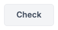              | 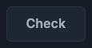              |
| Next button         | default               | real   |                       |                       |
| Next button         | hover                 | real   |                           |                           |
| Next button         | focus                 | real   |                           |                           |
| Hint link           | default               | real   |                           |                           |
| Hint link           | hover                 | real   |                               |                               |
| Hint link           | focus                 | real   |                               |                               |
| Sheet bar and Reset | disabled              | real   | 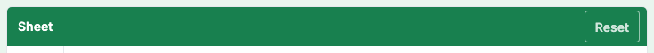    |     |
| Sheet bar and Reset | default               | real   |       | 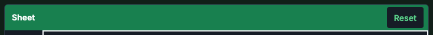      |
| Sheet bar and Reset | hover                 | real   |           | 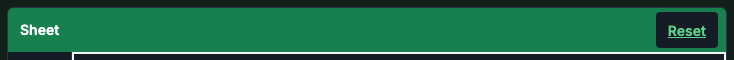          |
| Sheet bar and Reset | focus                 | real   | 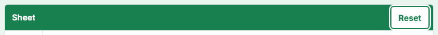          | 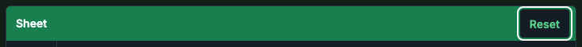          |
| Formula bar         | empty                 | real   | 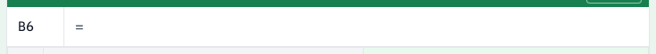                          | 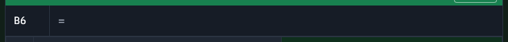                          |
| Formula bar         | focus                 | real   | 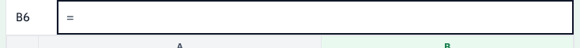                          | 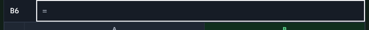                          |
| Formula bar         | typed                 | real   | 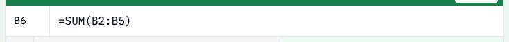                          | 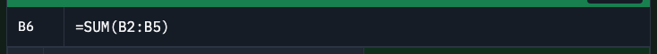                          |
| Formula bar         | error                 | real   | 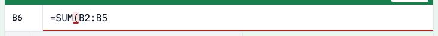                          | 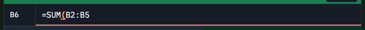                          |
| Formula bar         | read references       | real   | 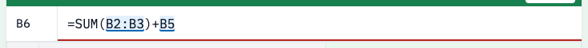      | 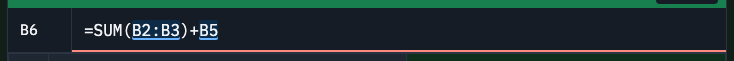      |
| Grid                | empty answer cell     | real   | 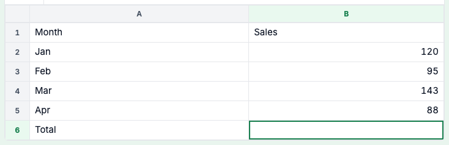                | 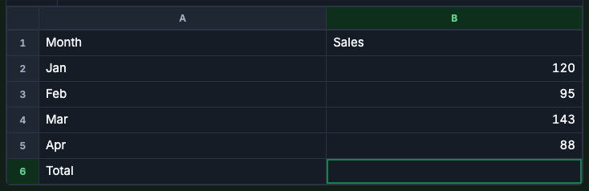                |
| Grid                | wrong                 | real   | 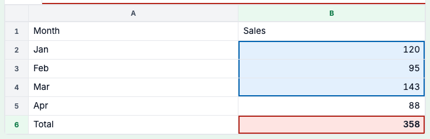                                        | 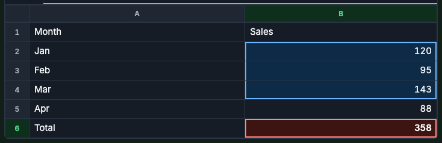                                        |
| Grid                | correct               | real   | 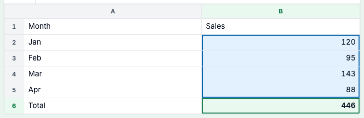                                    | 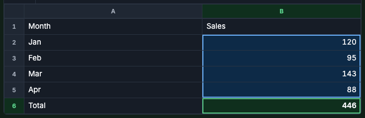                                    |
| Status bar          | empty                 | real   | 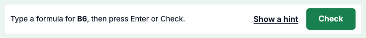                            | 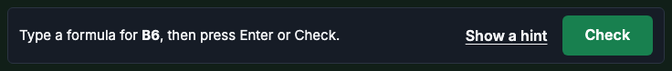                            |
| Status bar          | error, no formula     | real   | 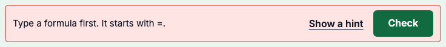     | 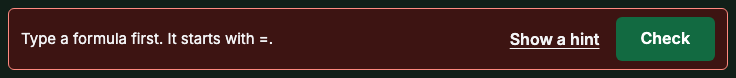     |
| Status bar          | error, wrong result   | real   | 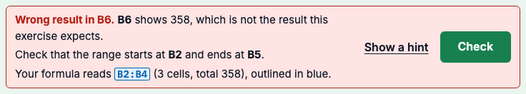 | 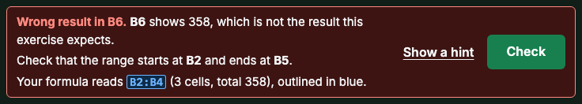 |
| Status bar          | error, syntax         | real   | 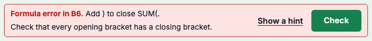             | 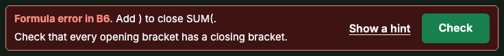             |
| Status bar          | correct               | real   |                         |                         |
| Hints               | closed                | real   | 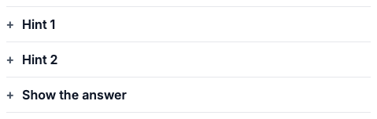                                    | 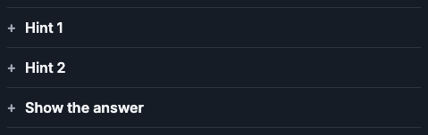                                    |
| Hints               | open, with comparison | real   | 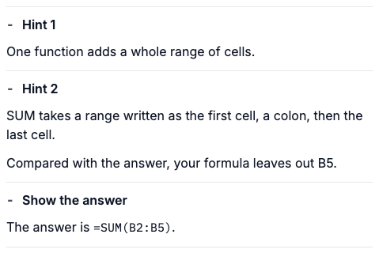       | 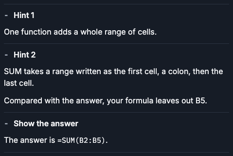       |
| Hints               | focus                 | real   | 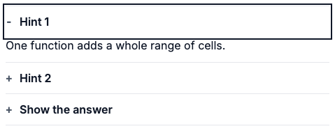                                      | 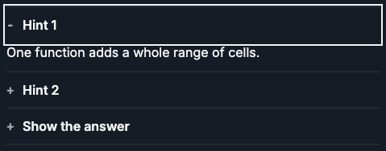                                      |
| Header              | default, current page | real   | 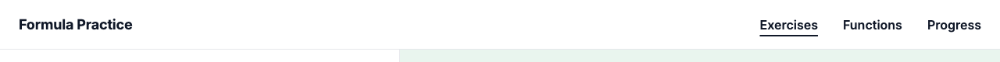     | 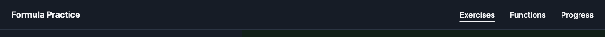     |
| Header              | link hover            | real   | 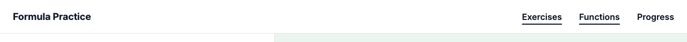                          | 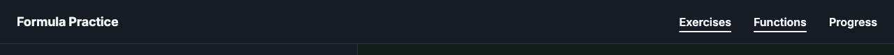                          |
| Header              | link focus            | real   | 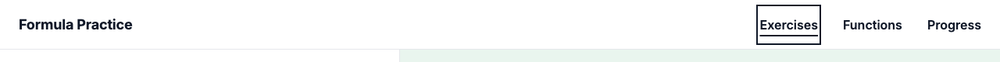                          | 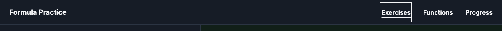                          |
| Header, phone       | default               | real   | 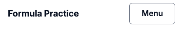                   | 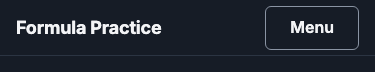                   |
| Header, phone       | menu hover            | real   | 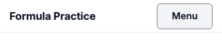             | 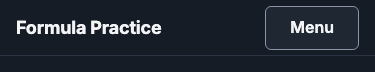             |
| Header, phone       | menu open             | real   | 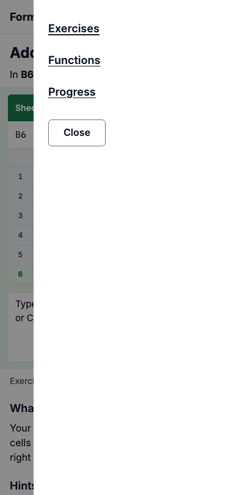               | 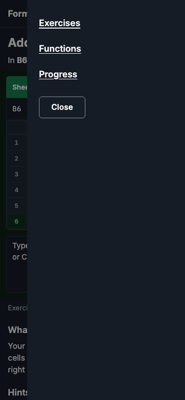               |
| Skip link           | focus                 | real   | 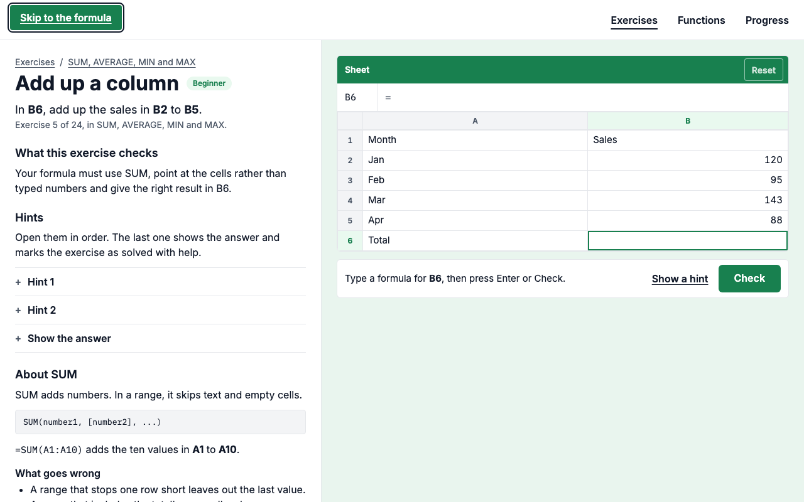                              |                               |
